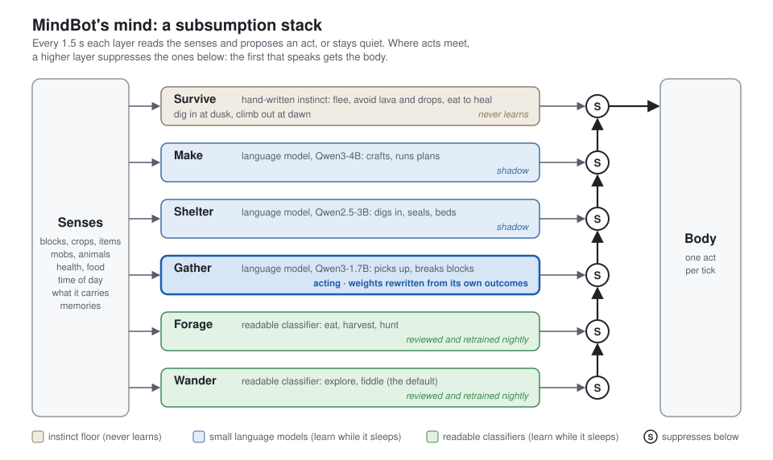

# Minecraft Mind

**MindBot: a Minecraft creature whose mind is a stack of behaviour layers, whose memory lives as plain markdown in an Obsidian vault, and which learns only while it sleeps, including by rewriting the weights of its own small language model from what happened to it.**

Built by Henry Risch (Bowdoin College), 2026, for PHIL 2400 *Minds and Machines*. The project asks two questions:
1. **How does a mind's behaviour change from day to day, and why?** Every change should be traceable to the night that caused it.
2. **Can a mind learn by itself?** Can one AI change another's weights to improve it, and what does that say about learning versus being taught?

## The mind now

A stack of layers, Rodney Brooks-style: each tick (1.5 s) every layer proposes an act or stays quiet, and the first that speaks gets the body.



- **No AI decides by day.** The layers act on their own. Claude Sonnet only *narrates*: it explains the body's acts in the first person without being told which layer caused them, like Gazzaniga's split-brain interpreter.
- **Memory** is an Obsidian vault of linked notes, with weights, embedding retrieval ([FreeLAB](https://github.com/Polarbear314/freelab)-style, using nomic-embed-text), and forgetting into gist notes. Nothing is ever deleted.
- **Sleep is the only time it changes.** At each dawn:
  - Claude Opus, its "hippocampus", **dreams**: it writes insights, goals and plans into the vault.
  - Opus **reviews the classifiers** and writes corrections to retrain on, or edits their weights directly. Each change has to pass a gate on the creature's own outcomes.
  - **The language-model layer's weights are rewritten from its own outcomes.** Every few Minecraft days, each Gather choice is judged by what happened next. A closed-form solve writes that lesson into the model's weights, and the patch is served only if it beats the live one on days it never trained on. Nothing about the right answer is fed in.

How the two learning paths fit together, with diagrams: **[docs/learning-model.md](docs/learning-model.md)**.

## Results so far

- **The creature lives well:** no deaths over days of stable play, it stays fed, hunts, harvests and bakes bread. Day-by-day measures are in [docs/results-days.md](docs/results-days.md).
- **One AI editing another's weights** ([docs/results-7b-trial.md](docs/results-7b-trial.md)), in a sandbox copy of Gather's model:
  - steering failed;
  - Opus's own neuron-level "surgery" fixed one flaw and broke the judgement around it;
  - a closed-form write fitted to the creature's labelled experience installed the judgement, and did so on two flaws and two models with Opus as the teacher;
  - the edit copies its teacher, blind spots included;
  - a protected learner can't discover the dangers it's protected from.
- **Live, nightly:** Gather's first self-taught patch passed its gate (0.56 → 0.60 balanced accuracy on held-out moments) and now runs in the creature. Its mistake rate is tracked day by day.
- **The full write-up:** [docs/mindbot-report-2026-11-18.md](docs/mindbot-report-2026-11-18.md) ([PDF](docs/mindbot-report-2026-11-18.pdf)), and a shorter [progress note](docs/progress-2026-11-18.md).

The main design, with the status of every stage, is [docs/design-subsumption.md](docs/design-subsumption.md). The earlier phases (a Claude-driven "cortex", brain regions, born-knowing reflexes, plans and skills) are documented in [docs/](docs/) and still run with `MIND=regions`.

## Run it

Needs Windows (the scripts are `.bat`/PowerShell), Node 18+, Minecraft **Java Edition 1.21.4** (a local server), and for the model layers an NVIDIA GPU (built on an RTX 3060, 12 GB) with a Python environment in `agent/.venv-laya` (PyTorch, transformers, bitsandbytes, and [Laya](https://github.com/NandhaKishorM/vegaml) for the triage). Claude is used through the Claude Code CLI on a normal account login; [Ollama](https://ollama.com) provides the embedding model.

```bash
cd agent
npm install
cp .env.example .env      # set VAULT_PATH, the server, and the settings below
npm run sim               # mock-world test of the whole pipeline, no server needed
```

Then `windows\start-all.bat` starts the server, the model service, the agent, the brain view (http://localhost:3008) and the triage.

| Setting (`agent/.env`) | What it does |
|---|---|
| `MIND=layers` | The behaviour stack (`regions` = the earlier Claude-driven design) |
| `GATHER_MODE=on` (also `SHELTER_MODE`, `MAKE_MODE`, `UPPER_LAYERS`) | Which model layers act; `shadow` logs their choices without acting |
| `GATHER_RULE=off` | Gather decides for itself when it's safe to gather (no fed-in rule) |
| `EXPLORE=0.2` | How often an acting layer tries its second choice |
| `NIGHTLY_WRITE=gather`, `WRITE_EVERY=3` | Rewrite Gather's weights from its outcomes every 3 Minecraft days |
| `EMBED_MODEL=nomic-embed-text` | Embedding retrieval for memory |

Useful commands, from `agent/`:
- `npm run days`: day-by-day measures, including Gather's learning curve;
- `npm run train-layers`: fit and gate the classifiers;
- `npm run recall -- "<situation>"`: what a layer would remember.

## What broke, and how it was fixed

- **It stood next to lava for 18 minutes.** It had no way to move away from a dangerous *block*. An `avoid` action and an instinct to step away from hazards fixed it.
- **Claude was too slow to drive every tick.** Calls take seconds, and the body froze. In the layers design no AI decides by day; Claude narrates and dreams.
- **It starved walking past food.** Crops were invisible to it, and plans kept a hungry body busy. It now sees crops, harvests, hunts, and pauses plans when hungry.
- **It dug itself 25 blocks underground.** The dig-in instinct sometimes lost count and kept digging, and there was no way back up. It now seals a shaft instead of deepening it, and climbs out at dawn by pillaring.
- **The nightly weight write kept getting cut off** by agent restarts. It now runs as its own detached process.
- **Version mismatch.** The Minecraft library doesn't support the newest game versions yet, so the world runs 1.21.4.

`npm run sim` (330+ checks) runs after every change.
