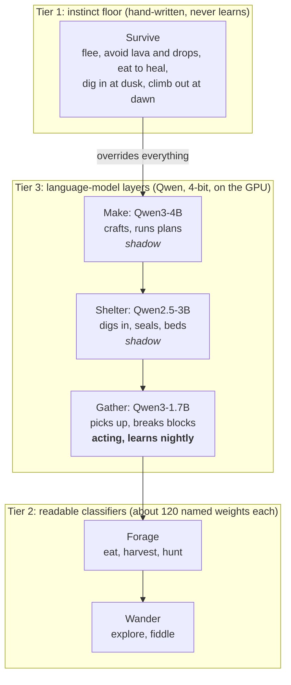
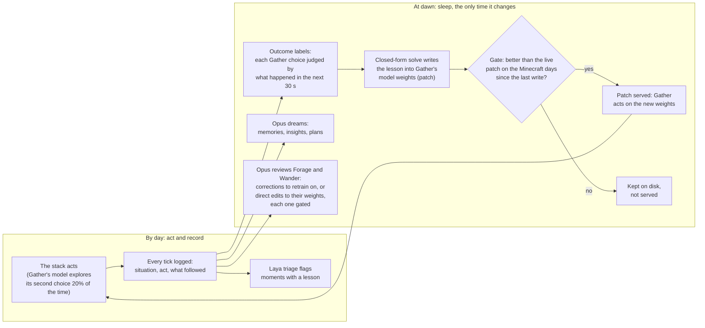

# MindBot's learning model

*How MindBot learns from its own experience while it sleeps (2026-11-18). The full design and status are in [design-subsumption.md](design-subsumption.md); the experiments behind the weight writes are in [results-7b-trial.md](results-7b-trial.md).*

## In one paragraph

MindBot is a creature in a small Minecraft world whose mind is a **stack of behaviour layers** in three tiers: a hand-written instinct floor, small readable classifiers, and small open language models. By day the stack acts and everything is logged: no AI decides for it. **At every dawn it sleeps, and that is the only time it changes.** There are two learning paths. Claude Opus, MindBot's "hippocampus", dreams over the day, writing memories and plans, and reviews or edits the small classifiers. Separately, the language-model layers' **weights are rewritten from the creature's own outcomes**: what each choice led to becomes a lesson, a closed-form solve writes it into the model, and a test on days the lesson never saw decides whether it's kept. Nothing about the right answer is fed in from outside on that path.

## The stack (first layer that speaks gets the body)

**The order is Survive > Make > Shelter > Gather > Forage > Wander.** Survive is listed at the bottom because it is the floor, but it overrides everything, like collision avoidance in Rodney Brooks's subsumption robots. **Shadow** means a layer's choices are logged beside the hand-written ones but don't move the body. **Acting** means its choices move the body.

## Day and night

## The two learning paths

| | **Path 1: the language-model layers** (running for Gather) | **Path 2: memory, plans and the classifiers** |
|---|---|---|
| What changes | The model's weights: about 0.5 million numbers in one layer of Qwen3-1.7B, kept as a versioned patch | Notes, gists and plans in the vault; the classifiers' weight tables |
| Who decides the lesson | **The creature's own outcomes.** Gathering that filled the pack unharmed means "do that"; gathering then hurt, failed or died means "don't". Nobody tells it what's right. | **Opus** reads the day: it dreams (writes insights and plans) and writes corrections or direct edits for Forage and Wander |
| How the change is made | A closed-form least-squares solve (MEMIT-style) at the model's second-to-last layer, protected so ordinary text is barely affected | Retraining on the corrections, or Opus editing named weights directly |
| What decides if it's kept | A **gate**: the edit must beat the currently live patch on Minecraft days it never trained on | A gate on the latest day's outcomes, for each classifier |
| How often | Every 3 Minecraft days (about once an hour) | Every Minecraft dawn |

So MindBot's experiences change its "brain" in two ways while it sleeps. Its language-model layer is rewritten directly from what happened to it. Its memories, plans and small classifiers are reshaped through Opus's dreaming and review.

## Where it stands (2026-11-18)

- **Gather learns from its own outcomes, on the live creature.**
  - The first patch passed its gate: balanced accuracy 0.56 → 0.60 on held-out moments.
  - A per-Minecraft-day write, tested on the days Gather has been acting, would pass 0.54 → 0.605.
  - Its mistake rate is tracked day by day in `npm run days` (37% on its first acting day).
- **Shelter and Make** run in shadow. They get the same loop once Gather shows a learning curve over several days.
- **Forage and Wander** are reviewed every night but haven't yet passed their gate.

## Why the path-1 lesson comes from outcomes, not from Opus

In the trial that led here (results-7b-trial.md), Opus was a strong *teacher*: given firm labels, it fixed a flaw in two different models. But the goal of this project is to see whether the creature can learn **by itself**, so the running loop uses only its own outcomes. That has a cost the trial found: a protected creature can't learn dangers it never meets. That's why Gather now acts, its fed-in safety rule is off, and it explores.
